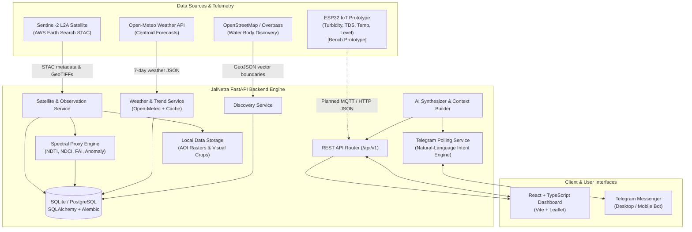
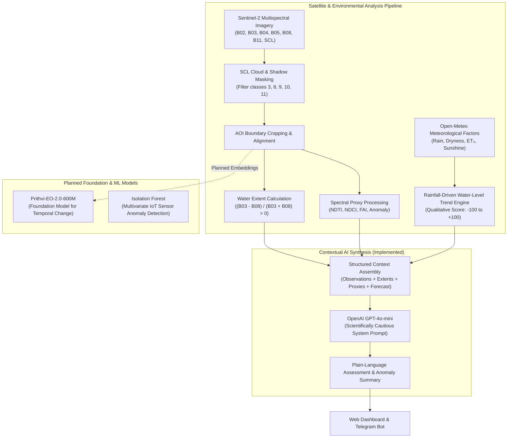
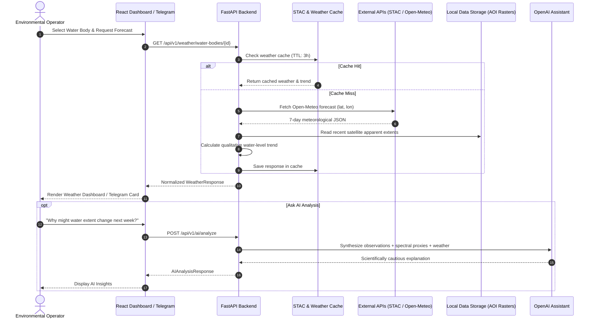

# JalNetra 2.0 — AI-Powered Water Intelligence Platform
### जलनेत्र · Intelligent Satellite, Weather & IoT Water-Body Monitoring

JalNetra 2.0 is an open-source environmental intelligence platform that unifies Sentinel-2 satellite remote sensing, real-time Open-Meteo weather intelligence, automated spectral proxy analysis, and an upcoming IoT physical sensing prototype to monitor lake and reservoir health, surface water extent, and environmental anomalies.

[](https://www.python.org/)
[](https://fastapi.tiangolo.com/)
[](https://react.dev/)
[](https://www.typescriptlang.org/)
[](https://vitejs.dev/)
[](#automated-testing--verification)
[](LICENSE)

> Imported from [AADi2oo6/JalNetra2.O](https://github.com/AADi2oo6/JalNetra2.O)
> at source commit `8244c2e`. Architecture descriptions and historical verification
> output below come from that project. In this repository, six targeted checks
> passed after the latest sync; the full backend suite and frontend build remain
> unverified. Secrets, caches, downloaded satellite data, and build artifacts are
> excluded. Configuration paths are resolved from the repository location:
> process environment variables override root `.env`, which overrides `backend/.env`.

---

## Table of Contents

- [Overview](#overview)
- [Problem Statement](#problem-statement)
- [Solution](#solution)
- [Key Features & Implementation Status](#key-features--implementation-status)
- [System Architecture](#system-architecture)
- [Technical Architecture](#technical-architecture)
- [AI & ML Architecture](#aiml-architecture)
- [Open-Source & Open-Weight AI Models](#open-source--open-weight-ai-models)
- [Satellite Remote-Sensing Intelligence](#satellite-remote-sensing-intelligence)
- [Weather Intelligence & Rainfall Trend](#weather-intelligence--rainfall-trend)
- [Interactive Web Dashboard](#interactive-web-dashboard)
- [Telegram Smart Assistant](#telegram-smart-assistant)
- [Telegram Setup & Configuration](#telegram-setup--configuration)
- [Data Flow](#data-flow)
- [IoT Sensing Architecture](#iot-sensing-architecture)
- [Current IoT Implementation Status](#current-iot-implementation-status)
- [Pending IoT Implementation Roadmap](#pending-iot-implementation-roadmap)
- [REST API Reference](#rest-api-reference)
- [Repository Structure](#repository-structure)
- [Installation & Local Setup](#installation--local-setup)
- [Environment Configuration](#environment-configuration)
- [Running the Application](#running-the-application)
- [Docker & Containerization](#docker--containerization)
- [Automated Testing & Verification](#automated-testing--verification)
- [Security & Scientific Guardrails](#security--scientific-guardrails)
- [System Limitations](#system-limitations)
- [Future Roadmap](#future-roadmap)
- [Hackathon Relevance](#hackathon-relevance)
- [Contributing](#contributing)
- [License](#license)

---

## Overview

Water security and freshwater ecosystems are increasingly threatened by climate variability, industrial discharge, agricultural runoff, and unregulated surface water extraction. **JalNetra 2.0 (जलनेत्र)** bridges macroscopic satellite observations and localized physical telemetry into an integrated, scientifically cautious early-warning platform:

1. **Satellite Intelligence**: Ingests Sentinel-2 multispectral imagery (AWS Earth Search STAC) directly over registered water-body Areas of Interest (AOI). Computes surface water extent, SCL-based cloud masks, and on-demand spectral proxies (NDTI, NDCI, FAI, and spectral anomalies).
2. **Weather Intelligence**: Queries the public Open-Meteo forecast API for centroid coordinates to evaluate current conditions, 7-day precipitation projections, and an inferred **Rainfall-Driven Water-Level Trend**.
3. **AI Interpretation**: Employs structured context generation and OpenAI language models to synthesize multi-temporal satellite observations, spectral proxies, and meteorological forecasts into plain-language summaries for environmental operators.
4. **IoT Physical Layer (Demonstration Prototype)**: A hardware sensor station built with ESP32, turbidity, TDS, temperature, and water-level sensors designed to capture localized physical water quality parameters. *(Hardware tested in standalone laboratory setups; cloud and dashboard telemetry ingestion is currently pending).*
5. **Multi-Interface Access**: Features an interactive React/Leaflet dashboard and a conversational Telegram bot capable of answering natural-language queries, displaying photos, providing Google Maps links, and generating status reports.

---

## Problem Statement

Traditional freshwater monitoring faces systemic operational hurdles:

- **Manual Grab Sampling**: Field sampling is labor-intensive, geographically sparse, and often executed weeks after a pollution or algal bloom event occurs.
- **Fragmented Data**: Satellite remote sensing, ground measurements, and meteorological forecasts are siloed across disconnected agencies and platforms.
- **High Cloud Ingestion Overhead**: Traditional scene-based satellite pipelines download massive multi-gigabyte tiles rather than clipping strictly to the lake's boundary.
- **Lack of Timely Public Access**: Ground-truth water observations are rarely accessible to local watershed managers or community stakeholders via accessible mobile channels.
- **Unverified Depth Claims**: Predictive systems often hallucinate exact water levels without physical gauges or calibrated hydrological catchment models.

---

## Solution

JalNetra 2.0 addresses these challenges through a unified, water-body-centric platform:

- **Water-Body-Centric Acquisition**: Clips Sentinel-2 observations strictly to the bounding box/polygon of the target water body, eliminating gigabytes of unneeded imagery.
- **Continuous Meteorological Forecasting**: Automatically pairs water bodies with Open-Meteo weather forecasts to project qualitative water-level tendencies.
- **On-Demand Spectral Proxies**: Computes turbidity, chlorophyll-a, floating algae, and spectral anomaly maps lazily without heavy upfront processing.
- **Multi-Source Data Fusion**: Connects historical satellite surface spread with upcoming precipitation projections to assess expansion or contraction risk.
- **Conversational Telegram Bot**: Enables natural-language lake queries, image retrieval, and weather cards without memorizing complex commands.
- **Demonstration IoT Prototype**: Establishes a scalable blueprint for localized in-situ sensor stations that will complement satellite remote sensing.

---

## Key Features & Implementation Status

| Feature | Description | Implementation Status |
|---|---|:---:|
| **Global Water Body Discovery** | Search and register water bodies via OpenStreetMap / Overpass API with vector boundaries and centroid calculation | ✅ Implemented |
| **Water-Body-Centric Satellite Fetch** | Query Sentinel-2 L2A STAC items, filter by cloud coverage, and download cropped RGB visual assets | ✅ Implemented |
| **SCL Cloud & Shadow Masking** | Pixel-level Scene Classification Layer (SCL) validation (filters clouds, cirrus, snow, and shadows) | ✅ Implemented |
| **Apparent Water Extent Analysis** | Normalized Green-NIR contrast `(B03 - B08)/(B03 + B08) > 0` calibrated against registered basin area | ✅ Implemented |
| **Temporal Change Slideshow** | Chronological playback of satellite observations with playback speed control and observation stepping | ✅ Implemented |
| **Dual Observation Comparison** | Split-screen visual swipe slider and pixel-difference highlighting between any two observation dates | ✅ Implemented |
| **Remote-Sensing Spectral Indices** | Lazy computation of NDTI (turbidity proxy), NDCI (chlorophyll-a proxy), FAI (algae proxy), and spectral anomaly | ✅ Implemented |
| **Weather Intelligence (Open-Meteo)** | Real-time conditions, 7-day forecast timeline, and SVG rainfall distribution chart (no API key required) | ✅ Implemented |
| **Rainfall-Driven Water-Level Trend** | Qualitative environmental trend engine (`LIKELY_RISING`, `STABLE`, `LIKELY_FALLING`, etc.) | ✅ Implemented |
| **AI Environmental Assistant** | Structured contextual interpretation of satellite, spectral, and weather data via OpenAI with read-only guardrails | ✅ Implemented |
| **Telegram Smart Assistant** | Natural-language query parsing, session memory, inline buttons, Google Maps links, and latest image delivery | ✅ Implemented |
| **Interactive Leaflet Map** | Vector boundary visualization, base map toggle, raster overlays, and compact weather badges | ✅ Implemented |
| **ESP32 Sensor Prototype** | Bench-tested breadboard prototype for temperature, TDS, turbidity, and relative water-level sensing | 🔵 Prototype (Hardware) |
| **IoT Cloud Telemetry Ingestion** | Ingestion endpoints, device authentication, and database persistence for live ESP32 sensor streams | 🚧 Planned (Pending) |
| **Live IoT Dashboard Cards** | Real-time sensor gauge widgets, live time-series charts, and threshold alerts on the web dashboard | 🚧 Planned (Pending) |
| **Open-Weight Foundation Models** | Prithvi-EO-2.0-600M satellite feature extraction and Isolation Forest IoT anomaly detection | 🚧 Planned (Model Integration) |

---

## System Architecture



---

## Technical Architecture

### Frontend Layer
- **Framework**: React 18 with TypeScript, compiled via Vite 6.
- **Mapping & Geospatial**: Leaflet and React-Leaflet with custom GeoJSON boundary overlays, image raster overlays, and bounding box computation.
- **Visual Analytics**: Interactive dual-observation comparison slider, chronological temporal slideshow, custom SVG extent charts, and SVG rainfall distribution bar charts.
- **Design System**: Environmental monitoring UI inspired by operational dashboards (light theme, high information density, emerald/blue/slate palette, sharp containers).

### Backend Layer
- **Engine**: Python 3.11+ powered by FastAPI and Uvicorn.
- **Database & ORM**: SQLAlchemy 2.0 with Alembic migrations and SQLite database (`jalnetra.db`), architected for clean PostgreSQL migration.
- **Raster & Geospatial Processing**: Rasterio, PyProj, NumPy, and Pillow for coordinate reference system (CRS) reprojection, WarpedVRT grid alignment, AOI clipping, and PNG/JPEG generation.
- **HTTP & Telemetry Client**: Asynchronous and synchronous HTTP via `httpx`.

### Cache & Storage Architecture
- **STAC Cache**: Caches raw STAC item responses for 24 hours (`data/cache/stac_*.json`).
- **Weather Cache**: In-memory cache with 30-minute TTL for current conditions and 3-hour TTL for 7-day forecasts, equipped with stale-fallback resilience.
- **Image Asset Storage**: Isolated directory hierarchy under `data/water_bodies/{water_body_id}/observations/` ensuring observations are strictly water-body-centric.

---

## AI & ML Architecture



---

## Open-Source & Open-Weight AI Models

JalNetra 2.0 is built to leverage open-weight Earth observation models and open-source machine learning:

| Model / Framework | Purpose | Parameter Count / Spec | License | Implementation Status |
|---|---|:---:|:---:|:---:|
| **Prithvi-EO-2.0-600M** | Satellite image feature extraction, multi-temporal representation learning, and optical change detection | ~600M Parameters (Transformer Foundation Model) | Apache-2.0 (IBM / NASA) | 🚧 Planned |
| **CloudSEN12 / UNet-MobileNetV2** | Deep-learning cloud, cirrus, and cloud-shadow segmentation on Sentinel-2 optical imagery | Lightweight CNN (~3.2M Parameters) | Open-Source Research Checkpoint | 🚧 Planned *(Current system uses Sentinel-2 SCL rule-based masking)* |
| **Isolation Forest** | Unsupervised multivariate anomaly detection on high-frequency IoT sensor telemetry streams | Ensemble of 100 Isolation Trees | BSD-3-Clause (`scikit-learn`) | 🚧 Planned (Pending IoT Integration) |
| **GPT-4o-mini** | Natural-language query translation, multi-modal contextual synthesis, and Telegram assistant | Cloud API (OpenAI) | Proprietary API | ✅ Implemented (Configurable) |

---

## Satellite Remote-Sensing Intelligence

JalNetra retrieves Sentinel-2 L2A bottom-of-atmosphere reflectance imagery via the public **Element84 AWS Earth Search STAC catalog** without requiring paid AWS credentials.

### Water-Body-Centric Focused Processing
Unlike legacy tools that process entire 100×100 km Sentinel-2 tiles, JalNetra clips imagery strictly to the registered water body's bounding box and vector polygon. This reduces bandwidth and local disk consumption by over 95%.

### Spectral Water Quality Proxies
All spectral indices are calculated lazily on-demand strictly within valid clear-sky water pixels:

1. **Normalized Difference Turbidity Index (NDTI)**:
   $$\text{NDTI} = \frac{\text{B04 (Red)} - \text{B03 (Green)}}{\text{B04 (Red)} + \text{B03 (Green)}}$$
   *Physical Meaning*: Optical proxy for suspended particulate matter, sediment load, and water turbidity.
2. **Normalized Difference Chlorophyll Index (NDCI)**:
   $$\text{NDCI} = \frac{\text{B05 (RedEdge1)} - \text{B04 (Red)}}{\text{B05 (RedEdge1)} + \text{B04 (Red)}}$$
   *Physical Meaning*: Optical proxy for chlorophyll-a concentration and phytoplankton biomass.
3. **Floating Algae Index (FAI)**:
   $$\text{FAI} = \text{B08 (NIR)} - \left[ \text{B04 (Red)} + (\text{B11 (SWIR1)} - \text{B04 (Red)}) \times \frac{842 - 665}{1610 - 665} \right]$$
   *Physical Meaning*: Identifies floating surface cyanobacteria, algal scums, and macrophytes.
4. **Multi-Band Spectral Anomaly**:
   Statistical deviation of green, red, red-edge, and NIR reflectance from the baseline distribution of the water body to flag unusual discoloration or sudden turbidity events.

> **Scientific Disclaimer**: Satellite-derived indices are remote-sensing optical proxies. They do not replace certified physical laboratory assays and are never converted into synthetic laboratory units (e.g., NTU or mg/m³).

---

## Weather Intelligence & Rainfall Trend

JalNetra integrates real-time meteorological conditions and multi-day forecasts via the public **Open-Meteo Weather Forecast API** (`https://api.open-meteo.com/v1/forecast`), requiring no API keys.

```text
Centroid Coordinates (lat, lon)
        │
        ▼
Open-Meteo API (7-Day Forecast)
        │
        ├── Current: Temperature, Humidity, Wind, Cloud Cover, Rainfall Today
        ├── Daily: Min/Max Temp, Rain Sum, Rain Probability, Sunshine, ET₀
        │
        ▼
Rainfall-Driven Water-Level Trend Engine
        │
        ├── Forecast Precipitation Contribution (+0 to +60)
        ├── Consecutive Rain & Probability Boost (+0 to +10)
        ├── Dryness & High Temperature Penalty (-0 to -55)
        └── Recent Satellite Extent Correlation (-25 to +25)
        │
        ▼
Qualitative Trend (Score: -100 to +100)
        ├── ↑ LIKELY_RISING
        ├── ↗ POSSIBLY_RISING
        ├── → STABLE
        ├── ↘ POSSIBLY_FALLING
        └── ↓ LIKELY_FALLING
```

### Scientific Guardrails
- **Qualitative Only**: The system explicitly outputs qualitative directions (`Likely Rising`, `Stable`, `Likely Falling`) and environmental reasoning narratives.
- **Zero Hallucination**: JalNetra **never** fabricates numerical water depths (e.g., *"water level will increase by 42 cm"*) from weather forecasts.

---

## Interactive Web Dashboard

The web dashboard is organized into specialized environmental monitoring workstations:

1. **Dashboard & Catalog (`/`)**: Displays registered lakes and reservoirs with geographic metadata, surface area, and system health status.
2. **Global Discovery (`/discovery`)**: Discovers lakes globally using OpenStreetMap Overpass by location name (e.g., *"Chhatrapati Sambhajinagar"*) or geographic bounding box.
3. **Monitoring Map (`/map`)**: Interactive Leaflet canvas featuring base map selection, water-body polygon boundaries, Sentinel-2 RGB visual overlays, cloud masks, water masks, and compact weather badges.
4. **Analysis Workstation (`/analysis`)**:
   - **Chronological Slideshow**: Steppable temporal playback with speed control (0.5× to 3×).
   - **Dual Observation Comparison**: Interactive swipe slider comparing visual RGB and spectral differences across dates.
   - **Apparent Water Extent Over Time**: Time-series chart tracking surface spread fluctuations against registered basin limits.
   - **Weather & Water Forecast**: Current conditions, 7-day forecast cards, SVG rainfall bar chart, and qualitative water-level trend panel.
   - **Spectral Analysis Workstation**: On-demand computation of NDTI, NDCI, FAI, and spectral anomalies with AOI masking.
   - **AI Assistant Panel**: Pre-configured query buttons and custom inquiry bar with scientific guardrails.

---

## Telegram Smart Assistant

JalNetra features an integrated Telegram bot capable of natural-language conversation and backwards-compatible slash commands:

### Natural Language Interactions
Users do not need to memorize commands. The bot deterministically parses plain English:
- *"Show Salim Ali Lake"* $\to$ Delivers water-body summary card, location, and latest observation date.
- *"Give me the latest image of Salim Ali Lake"* $\to$ Resolves the newest verified local satellite observation on disk and uploads the photo.
- *"How is the water at Salim Ali Lake?"* $\to$ Reports remote-sensing optical water quality proxies and simple clarity explanations.
- *"Where is Salim Ali Lake?"* $\to$ Delivers coordinates and an active Google Maps link (`https://www.google.com/maps/search/?api=1&query=<lat>,<lon>`).
- *"What is the weather at Salim Ali Lake?"* $\to$ Fetches real-time temperature, rain today, 7-day rainfall total, and the qualitative water-level trend.
- *"How often does it change?"* $\to$ Follow-up pronoun resolved via multi-turn session memory (`_chat_context`).

### Supported Commands Reference

| Command | Purpose | Example | Expected Output |
|---|---|---|---|
| `/start` | Welcome and introduction | `/start` | Overview of bot capabilities, plain-text usage guide, and supported query types. |
| `/help` | Detailed function guide | `/help` | Complete syntax guide, natural-language examples, and disclaimer notes. |
| `/ping` | Connectivity liveness check | `/ping` | Replies with `pong` and latency confirmation. |
| `/status` | Platform health diagnostics | `/status` | Backend status (ONLINE), AI status (CONFIGURED), Database (ONLINE), and Telegram connection. |
| `/list` | List registered water bodies | `/list` | Numbered list of all active water bodies monitored by the platform. |
| `/waterbody <name>` | Comprehensive lake summary card | `/waterbody Salim Ali Lake` | Structured card with area, location, latest observation, inline buttons, and photo upload. |
| `/ai <question>` | Ask JalNetra AI assistant | `/ai What is NDTI?` | Scientifically cautious response explaining remote-sensing proxies or water-body conditions. |

### Interactive Inline Buttons
Every lake card includes dynamic inline action buttons:
- `[ 🛰 Latest Image ]`: Uploads the newest verified visual satellite image crop.
- `[ 🗺 Open in Google Maps ]`: Direct clickable navigation link to water-body coordinates.
- `[ 💧 Water Quality ]`: Displays optical proxy summary and clarity interpretations.
- `[ 🌤 Weather ]`: Generates current temperature, 7-day rainfall, and water-level trend.
- `[ 📊 Monitoring ]`: Returns historical sensing frequency and observation counts.

---

## Telegram Setup & Configuration

1. **Create Bot**: Message `@BotFather` on Telegram, send `/newbot`, and follow instructions to obtain your bot token.
2. **Add to `.env`**:
   ```env
   TELEGRAM_ENABLED=true
   TELEGRAM_BOT_TOKEN=your_telegram_bot_token_here
   TELEGRAM_BOT_USERNAME=your_bot_username
   TELEGRAM_ALLOWED_CHAT_IDS=
   ```
   *(Leave `TELEGRAM_ALLOWED_CHAT_IDS` empty to allow public access, or add comma-separated IDs to restrict access).*
3. **Run Backend**: When `uvicorn` starts, `telegram_bot_service` initializes in the background and begins long-polling.

---

## Data Flow



---

## IoT Sensing Architecture

The IoT physical monitoring subsystem is designed as an in-situ sensing node to complement macroscopic satellite observations with continuous, high-frequency physical telemetry.

```text
               +-------------------------------------------+
               |        JalNetra In-Situ IoT Node          |
               |                                           |
               |   [Turbidity Sensor] (Turbidity Proxy)    |
               |   [TDS Sensor]       (Dissolved Solids)   |
               |   [DS18B20]          (Water Temperature)  |
               |   [Water Level]      (Relative Elevation) |
               +---------------------+---------------------+
                                     |
                                     ▼
                      +-----------------------------+
                      |   ESP32 Microcontroller     |
                      |   - Analog ADC Filtering    |
                      |   - 1-Wire Digital Bus      |
                      |   - JSON Telemetry Builder  |
                      |   - Wi-Fi 802.11 b/g/n      |
                      +--------------+--------------+
                                     |
                                     ▼ (Planned Telemetry)
                             HTTP POST / MQTT
                                     |
                                     ▼
               +-------------------------------------------+
               |        JalNetra Backend Ingestion         |
               |   - Telemetry Validation & Auth           |
               |   - SQLite / PostgreSQL Time-Series Store |
               |   - Isolation Forest Anomaly Detection    |
               +-------------------------------------------+
```

### Sensor Specifications & Hardware Roles

- **ESP32 DevKit V1**: 32-bit dual-core Tensilica Xtensa 240 MHz MCU with integrated 2.4 GHz Wi-Fi and Bluetooth. Manages multi-channel analog sampling, digital sensor bus polling, and telemetry packet generation.
- **Turbidity Sensor (Analog Optical)**: Employs infrared optical transmittance to detect light scattering caused by suspended solids and particulate matter.
- **TDS Sensor (Total Dissolved Solids)**: Measures electrical conductivity via titanium probes to estimate dissolved ion concentrations in parts per million (ppm).
- **DS18B20 Temperature Sensor**: Waterproof digital probe using the Maxim 1-Wire protocol with 9 to 12-bit programmable resolution ($-55^\circ\text{C}$ to $+125^\circ\text{C}$).
- **Relative Water-Level Sensor (SEN18 / Conductive Array)**: Submersible resistance trace sensor tracking localized relative stage changes.

---

## Current IoT Implementation Status

> [!IMPORTANT]
> The IoT hardware station is currently a **demonstration prototype** tested in breadboard and standalone bench environments. Live telemetry streaming to the backend database, real-time dashboard widgets, and automated Telegram sensor alerts are **planned for upcoming development phases**.

| Subsystem Component | Current Status | Description |
|---|:---:|---|
| **ESP32 Firmware Core** | 🔵 Prototype | Multi-sensor acquisition loop reading analog and 1-Wire inputs. |
| **DS18B20 Temperature Sensor** | 🔵 Tested | Validated in bench testing on digital 1-Wire bus. |
| **Turbidity Sensor** | 🔵 Tested | Validated in bench testing with clean vs. turbid water samples. |
| **TDS Sensor** | 🔵 Tested | Validated in bench testing with conductivity references. |
| **Relative Water-Level Sensor** | 🔵 Tested | Validated in stepped submersion container testing. |
| **OLED Local Display** | 🚧 Pending | SSD1306 display integration for field-level telemetry display. |
| **Multi-Point Sensor Calibration** | 🚧 Pending | Chemical buffer calibration (NTU, ppm, temperature offsets). |
| **Standardized JSON Serializer** | 🚧 Pending | Formalized telemetry payload formatting on the MCU. |
| **Wi-Fi / MQTT Streaming** | 🚧 Pending | Resilient Wi-Fi reconnection and MQTT message broker streaming. |
| **Backend Ingestion API** | 🚧 Planned | `POST /api/v1/iot/telemetry` endpoint with API key authentication. |
| **Time-Series Database Store** | 🚧 Planned | Storage schema for high-frequency in-situ sensor telemetry. |
| **Live Dashboard Telemetry Cards** | 🚧 Planned | Real-time gauge cards and historical sensor charts in React. |
| **Telegram Threshold Alerts** | 🚧 Planned | Automated alerts triggered by abrupt physical parameter deviations. |
| **Sensor-Satellite ML Fusion** | 🚧 Planned | Cross-correlation between satellite spectral indices and IoT telemetry. |

---

## Pending IoT Implementation Roadmap

The planned engineering progression for full IoT integration includes:

### Phase 1: Hardware Hardening & Input Protection
- Design dedicated PCB or perfboard daughtercard with voltage regulation (5V to 3.3V logic translation).
- Add RC low-pass filtering and pull-up resistors on analog sensor inputs to suppress electrical noise.

### Phase 2: Multi-Point Laboratory Calibration
- Calibrate the turbidity sensor using standardized Formazin turbidity units (NTU).
- Calibrate the TDS sensor using 1413 µS/cm conductivity reference solution.
- Establish container-specific hydrostatic or conductive resistance curves for relative water level.

### Phase 3: Firmware Telemetry Architecture
Implement structured JSON telemetry serialization on the ESP32:
```json
{
  "device_id": "JALNETRA_NODE_001",
  "water_body_id": "1bdb5a8e-5295-4791-859c-000343898f6f",
  "timestamp": "2026-10-16T12:00:00Z",
  "readings": {
    "water_temperature_c": 26.4,
    "tds_ppm": 312,
    "turbidity_ntu_proxy": 14.8,
    "relative_water_level_pct": 58.2
  },
  "diagnostics": {
    "wifi_rssi_dbm": -64,
    "battery_voltage": 3.94
  }
}
```

### Phase 4: Secure Network Streaming
- Support secure HTTP POST and lightweight MQTT over TLS (`mqtts://`).
- Implement an on-chip ring buffer in flash memory to queue readings during Wi-Fi outages.

### Phase 5: Backend Ingestion & Database Persistence
- Implement `POST /api/v1/iot/telemetry` with token-based device authentication.
- Persist high-frequency telemetry in an optimized time-series table.

### Phase 6: Live Dashboard Visualization
- Add a dedicated **IoT Physical Telemetry Station** tab in the React dashboard.
- Display real-time gauge widgets and historical trend lines for turbidity, TDS, temperature, and water level.

### Phase 7: AI Anomaly Detection & Sensor Fusion
- Deploy an **Isolation Forest** model to detect multivariate outliers in physical telemetry.
- Correlate IoT turbidity readings with satellite NDTI proxies to validate sediment events.

### Phase 8: Proactive Telegram Alerts
- Transmit immediate push alerts when sensor readings breach critical environmental thresholds.

---

## REST API Reference

The backend exposes a structured, OpenAPI-compliant REST API under `/api/v1`.

### Weather Intelligence APIs
| Method | Endpoint | Description |
|---|---|---|
| `GET` | `/api/v1/weather/status` | Operational status of weather integration (`Open-Meteo`, requires no API key). |
| `GET` | `/api/v1/weather/water-bodies/{id}` | Comprehensive current weather, 7-day forecast, and qualitative water-level trend. |
| `GET` | `/api/v1/weather/water-bodies/{id}/forecast` | 7-day daily forecast list only. |
| `GET` | `/api/v1/weather/water-bodies/{id}/impact` | Qualitative rainfall impact and water-level trend analysis only. |

### Water Bodies & Discovery APIs
| Method | Endpoint | Description |
|---|---|---|
| `GET` | `/api/v1/water-bodies/` | List registered water bodies with pagination and search filters. |
| `POST` | `/api/v1/water-bodies/` | Register a new water body with name, location, and GeoJSON geometry. |
| `GET` | `/api/v1/water-bodies/{id}` | Retrieve water body metadata, centroid, and area. |
| `GET` | `/api/v1/water-bodies/{id}/visual-status` | Check observation counts, stored image availability, and Google Maps URL. |
| `GET` | `/api/v1/water-bodies/{id}/observations/{obs_id}/visual` | Directly serves the verified visual image file (`FileResponse`). |
| `GET` | `/api/v1/discovery/search` | Search locations and discover water bodies via OpenStreetMap Overpass. |
| `POST` | `/api/v1/discovery/import` | Batch-import discovered water bodies into the platform database. |

### Satellite & Visual Data APIs
| Method | Endpoint | Description |
|---|---|---|
| `GET` | `/api/v1/water-bodies/{id}/visual-data/available-observations` | Query available Sentinel-2 dates for the water-body AOI. |
| `POST` | `/api/v1/water-bodies/{id}/visual-data/fetch-selected` | Fetch and clip cropped RGB visual data for selected observation IDs. |
| `GET` | `/api/v1/water-bodies/{id}/observations` | List local observations stored on disk for a water body. |
| `GET` | `/api/v1/water-bodies/{id}/observations/{obs_id}/image` | Serve clipped visual imagery for a specific observation. |
| `GET` | `/api/v1/water-bodies/{id}/analysis` | Compute multi-temporal apparent water extent and surface changes. |

### Spectral Analysis & AI APIs
| Method | Endpoint | Description |
|---|---|---|
| `GET` | `/api/v1/spectral/indicators` | List available spectral indices (NDTI, NDCI, FAI, anomaly). |
| `GET` | `/api/v1/spectral/summary` | Compute multi-indicator spectral summary for an observation. |
| `GET` | `/api/v1/spectral/timeseries` | Compute time-series spectral trends across all observations. |
| `GET` | `/api/v1/ai/status` | Check AI assistant configuration and OpenAI connectivity status. |
| `POST` | `/api/v1/ai/analyze` | Ask an analysis question with structured multi-modal context. |

### System & Diagnostics APIs
| Method | Endpoint | Description |
|---|---|---|
| `GET` | `/api/v1/health` | System health, service name, and version check. |
| `GET` | `/api/v1/storage/status` | Disk utilization, scene counts, and cache entry audit. |
| `POST` | `/api/v1/storage/reset` | Administrative reset of database and file storage. |
| `GET` | `/api/v1/telegram/status` | Telegram bot service state, username, and polling diagnostics. |

---

## Repository Structure

```text
JalNetra2.0/
├── backend/
│   ├── alembic/                         # Database schema migration scripts
│   ├── app/
│   │   ├── api/v1/                      # FastAPI modular route endpoints
│   │   │   ├── ai.py                    # AI Assistant endpoints
│   │   │   ├── analysis.py              # Temporal change & extent analysis
│   │   │   ├── discovery.py             # OSM Overpass water body discovery
│   │   │   ├── health.py                # Health & status endpoints
│   │   │   ├── map.py                   # Map vector & raster overlay routes
│   │   │   ├── processing.py            # Legacy scene processing routes
│   │   │   ├── satellite.py             # STAC scene discovery & acquisition
│   │   │   ├── spectral.py              # On-demand spectral indicator routes
│   │   │   ├── storage.py               # Cache & storage management routes
│   │   │   ├── telegram.py              # Telegram bot status endpoint
│   │   │   ├── visual_data.py           # Focused visual acquisition routes
│   │   │   ├── water_bodies.py          # Water body CRUD & visual status
│   │   │   └── weather.py               # Open-Meteo weather & trend routes
│   │   ├── core/                        # Centralized settings & path management
│   │   ├── db/                          # Database connection, base, and models
│   │   │   ├── models/                  # SQLAlchemy ORM models
│   │   │   └── repositories/            # Data access repository patterns
│   │   ├── schemas/                     # Pydantic validation models
│   │   └── services/                    # Core business logic services
│   │       ├── ai/                      # OpenAI client, prompts & context builder
│   │       ├── discovery/               # OSM discovery provider
│   │       ├── raster/                  # GeoTIFF CRS warping & clipping
│   │       ├── satellite/               # STAC client & image resolver
│   │       ├── spectral/                # Spectral indicator calculation engine
│   │       ├── storage/                 # Local directory & reset service
│   │       ├── telegram/                # Telegram bot, client, intents & handlers
│   │       └── weather/                 # Open-Meteo client, cache & trend engine
│   ├── tests/                           # Pytest automated test suites (163 tests)
│   ├── alembic.ini                      # Alembic migration configuration
│   ├── requirements.txt                 # Python dependencies
│   └── .env.example                     # Backend environment variable template
├── frontend/
│   ├── src/
│   │   ├── api/                         # Frontend API clients (client.ts, weather.ts)
│   │   ├── components/                  # Reusable React components
│   │   │   ├── CompactWeatherBadge.tsx  # Compact weather badge for map cards
│   │   │   ├── FetchVisualDataModal.tsx # Focused satellite fetch modal
│   │   │   ├── Header.tsx               # Application header
│   │   │   ├── Navigation.tsx           # Primary tab navigation
│   │   │   └── WeatherSection.tsx       # Weather & water forecast dashboard
│   │   ├── pages/                       # Primary application views
│   │   │   ├── AnalysisPage.tsx         # Comprehensive analysis workstation
│   │   │   ├── Dashboard.tsx            # Water-body catalog & management
│   │   │   ├── DiscoveryPage.tsx        # Global lake discovery view
│   │   │   ├── MapPage.tsx              # Interactive monitoring map
│   │   │   └── SatellitePage.tsx        # STAC scene search view
│   │   ├── App.tsx                      # Root application component
│   │   └── main.tsx                     # Vite application entry point
│   ├── package.json                     # Frontend dependencies & scripts
│   ├── tsconfig.json                    # TypeScript compiler configuration
│   └── vite.config.ts                   # Vite bundler configuration
├── data/                                # Local storage for database, cache, imagery
├── docs/                                # Technical phase specifications & audits
├── scripts/                             # Maintenance scripts (audit, reset)
├── .env.example                         # Root environment template
├── .gitignore                           # Git ignore rules
└── README.md                            # Comprehensive project documentation
```

---

## Installation & Local Setup

### Prerequisites
- **Python**: Version 3.11, 3.12, or 3.13
- **Node.js**: Version 18.x or 20.x
- **npm**: Version 9.x or 10.x
- **Git**: Installed and configured

### 1. Clone Repository
```bash
git clone https://github.com/ishwarc04/JalNetra.git
cd JalNetra
```

### 2. Backend Setup
```bash
# Navigate to backend directory
cd backend

# Create virtual environment
python -m venv .venv

# Activate virtual environment
# Windows (PowerShell):
.\.venv\Scripts\Activate.ps1
# Linux / macOS:
source .venv/bin/activate

# Install dependencies
pip install -r requirements.txt

# Create environment configuration
copy .env.example .env   # Windows
# or: cp .env.example .env # Linux/macOS
```

### 3. Frontend Setup
```bash
# Open a new terminal in the frontend directory
cd frontend

# Install Node dependencies
npm install
```

---

## Environment Configuration

Configure variables in `backend/.env`:

| Variable | Description | Default / Example | Required |
|---|---|---|:---:|
| `APP_NAME` | Name of the backend application | `JalNetra API` | No |
| `APP_VERSION` | Current application version | `2.0.0` | No |
| `ENVIRONMENT` | Runtime environment mode | `development` | No |
| `DEBUG` | Enable debug logging and stack traces | `true` | No |
| `DATABASE_URL` | SQLAlchemy connection string | `sqlite:///./data/database/jalnetra.db` | Yes |
| `DATA_DIR` | Local storage root directory | `./data` | Yes |
| `FRONTEND_URL` | Allowed CORS origin for frontend | `http://localhost:5173` | Yes |
| `WATERBODY_DISCOVERY_ENABLED` | Enable OSM water body discovery | `true` | No |
| `SATELLITE_PROVIDER` | STAC satellite data provider | `earth_search` | Yes |
| `SATELLITE_STAC_URL` | Public STAC catalog endpoint | `https://earth-search.aws.element84.com/v1` | Yes |
| `AI_ENABLED` | Enable OpenAI contextual assistant | `true` | No |
| `OPENAI_API_KEY` | OpenAI API key for AI assistant | `sk-...` | Optional *(Required only for `/ai`)* |
| `OPENAI_MODEL` | OpenAI model identifier | `gpt-4o-mini` | No |
| `TELEGRAM_ENABLED` | Enable Telegram polling service | `true` | No |
| `TELEGRAM_BOT_TOKEN` | Telegram bot token from `@BotFather` | `123456789:ABCdef...` | Optional *(Required only for Telegram)* |
| `TELEGRAM_BOT_USERNAME` | Configured bot username | `jalNetra_Helperbot` | No |
| `TELEGRAM_ALLOWED_CHAT_IDS` | Restrict bot access to specific chat IDs | `""` *(empty allows all)* | No |

---

## Running the Application

### 1. Start the Backend API Server
From `backend/` with the virtual environment activated:
```bash
uvicorn app.main:create_app --factory --host 127.0.0.1 --port 8000 --reload
```
- Interactive API Documentation: [http://127.0.0.1:8000/docs](http://127.0.0.1:8000/docs)
- Alternative ReDoc: [http://127.0.0.1:8000/redoc](http://127.0.0.1:8000/redoc)
- Health Check: [http://127.0.0.1:8000/api/v1/health](http://127.0.0.1:8000/api/v1/health)

### 2. Start the Frontend Development Server
From `frontend/`:
```bash
npm run dev
```
- The dashboard is accessible at: [http://localhost:5173](http://localhost:5173)

---

## Docker & Containerization

> [!NOTE]
> Standard containerization (`Dockerfile` and `docker-compose.yml`) is architected for upcoming cloud deployment. Currently, the platform runs natively via Python 3.11+ and Node 18+.

**Planned Container Architecture**:
- `jalnetra-backend`: FastAPI application container with GDAL/Rasterio C-libraries.
- `jalnetra-frontend`: Nginx Alpine container serving optimized Vite static bundles.
- `jalnetra-db`: PostgreSQL 16 + PostGIS container replacing SQLite for high-concurrency production deployments.

---

## Automated Testing & Verification

JalNetra 2.0 maintains a comprehensive automated test suite verifying storage integrity, satellite acquisitions, spectral computations, weather modeling, Telegram intents, and AI services.

### Running Backend Tests
From `backend/` with the virtual environment activated:
```bash
pytest -v
```

**Historical test results reported by the source repository (not rerun here)**:
```text
tests/test_ai_service.py ................................ PASSED (7 tests)
tests/test_api_endpoints.py ............................. PASSED (4 tests)
tests/test_audit_storage.py ............................. PASSED (6 tests)
tests/test_discovery_api.py ............................. PASSED (3 tests)
tests/test_discovery_service.py ......................... PASSED (8 tests)
tests/test_health_and_config.py .......................... PASSED (7 tests)
tests/test_map_api.py .................................... PASSED (8 tests)
tests/test_persistence.py ............................... PASSED (1 test)
tests/test_phase2_discovery.py .......................... PASSED (10 tests)
tests/test_phase3_import.py ............................. PASSED (6 tests)
tests/test_processing_api.py ............................ PASSED (2 tests)
tests/test_processing_service.py ......................... PASSED (4 tests)
tests/test_raster_service.py ............................. PASSED (5 tests)
tests/test_repositories_and_models.py .................... PASSED (4 tests)
tests/test_satellite_api.py ............................. PASSED (2 tests)
tests/test_satellite_service.py ......................... PASSED (5 tests)
tests/test_smart_assistant.py ........................... PASSED (7 tests)
tests/test_spectral_indicators.py ....................... PASSED (8 tests)
tests/test_storage_reset.py ............................. PASSED (12 tests)
tests/test_storage_service.py ........................... PASSED (7 tests)
tests/test_telegram_service.py .......................... PASSED (18 tests)
tests/test_visual_data_and_analysis.py .................. PASSED (11 tests)
tests/test_water_body_summary_service.py ................ PASSED (7 tests)
tests/test_weather_service.py ........................... PASSED (11 tests)

====================== 163 passed in 112.84s ======================
```

### Running Frontend Verification
From `frontend/`:
```bash
npm run build
```
**Historical build output reported by the source repository (not rerun here)**:
```text
> tsc -b && vite build
✓ 84 modules transformed.
dist/index.html                   0.44 kB │ gzip:   0.29 kB
dist/assets/index-DTtGEOvX.css   16.64 kB │ gzip:   6.89 kB
dist/assets/index-CXcfDeJQ.js   536.17 kB │ gzip: 147.73 kB
✓ built in 2.18s
```

---

## Security & Scientific Guardrails

1. **Secret & Credential Isolation**: API keys (`OPENAI_API_KEY`, `TELEGRAM_BOT_TOKEN`) are strictly managed through environment variables and never committed, logged, or returned in client API responses.
2. **Local Filesystem Sandboxing**: File resolvers prevent directory traversal attacks by validating resolved paths against the authorized `data/` directory root.
3. **Strict Read-Only Guardrails**: The Telegram bot and AI Assistant are strictly read-only for water-body data. They cannot execute shell commands, alter database records, or trigger server-side deletions.
4. **Scientific Proxy Distinction**: Optical remote sensing proxies are explicitly labeled as uncalibrated mathematical indices rather than certified laboratory metrics.
5. **No Hallucinated Depth**: The system never projects absolute numerical water depths from rainfall forecasts.

---

## System Limitations

- **IoT Integration Pending**: The ESP32 sensor station is a demonstration prototype; live field streaming to the dashboard is under active development.
- **Relative Water Level**: The current sensor prototype tracks relative stage fluctuations rather than absolute bathymetric elevation.
- **Optical Satellite Limitations**: Sentinel-2 optical imagery cannot penetrate dense cloud cover; valid observations depend on clear-sky orbits (revisit period ~5 days).
- **Meteorological Trends vs. Hydrology**: Rainfall-driven trends are inferred environmental signals and do not replace physically calibrated catchment models.

---

## Future Roadmap

- [x] Global Water-Body Discovery & Vector Polygon Registration
- [x] Focused Water-Body-Centric Sentinel-2 Visual Imagery Acquisition
- [x] Pixel-Level Cloud & Water Mask Preprocessing (SCL & Green-NIR Contrast)
- [x] Apparent Water Extent Time-Series Tracking & Temporal Slideshow
- [x] Dual-Observation Swipe Comparison & Difference Highlighting
- [x] On-Demand Remote-Sensing Spectral Proxies (NDTI, NDCI, FAI, Anomaly)
- [x] Real-Time Weather Intelligence & 7-Day Precipitation Forecasting (Open-Meteo)
- [x] Qualitative Rainfall-Driven Water-Level Trend Engine
- [x] Contextual AI Assistant with Read-Only Scientific Guardrails
- [x] Conversational Telegram Smart Assistant with Photo Delivery & Google Maps
- [ ] Complete Multi-Point Laboratory Sensor Calibration (NTU, TDS, Level)
- [ ] Standardized ESP32 JSON Telemetry Streaming over Wi-Fi / MQTT
- [ ] Backend IoT Ingestion API (`POST /api/v1/iot/telemetry`)
- [ ] Real-Time Physical Sensor Gauges on Web Dashboard
- [ ] Unsupervised IoT Anomaly Detection (Isolation Forest)
- [ ] Open-Weight Earth Observation Foundation Model Integration (Prithvi-EO-2.0-600M)
- [ ] Proactive Telegram Push Alerts on Environmental Threshold Violations
- [ ] Production Multi-Container Docker Deployment (PostgreSQL + PostGIS)

---

## Hackathon Relevance

JalNetra 2.0 is tailored for the **Open-Weight / Open-Source AI Track**:

- **Foundational Environmental Intelligence**: AI is not implemented as a superficial chat wrapper. It synthesizes multispectral satellite imagery, spectral proxies, and meteorological factors to extract environmental signals.
- **Architected for Open-Weight Foundation Models**: The processing pipeline is structured to ingest open-weight foundation models like IBM/NASA's **Prithvi-EO-2.0-600M** for temporal change detection and scikit-learn's **Isolation Forest** for multivariate sensor anomaly detection.
- **100% Free & Open-Source Stack**: Operates on open public infrastructure (Element84 AWS Earth Search STAC catalog, Open-Meteo, OpenStreetMap Overpass, FastAPI, React, and Leaflet).
- **High Societal & Ecological Impact**: Directly addresses UN Sustainable Development Goal 6 (Clean Water and Sanitation) by making lake and reservoir monitoring accessible to communities and conservationists.

---

## Contributing

Contributions from hydrologists, remote sensing specialists, software engineers, and environmentalists are welcome!

1. **Fork the Repository**
2. **Create a Feature Branch**:
   ```bash
   git checkout -b feature/environmental-enhancement
   ```
3. **Commit Your Changes**:
   ```bash
   git commit -m "Add new spectral indicator calculation"
   ```
4. **Ensure All Automated Tests Pass**:
   ```bash
   pytest
   npm --prefix frontend run build
   ```
5. **Open a Pull Request** describing your enhancement, technical rationale, and verification steps.

---

## License

This repository includes an [MIT license](LICENSE).
