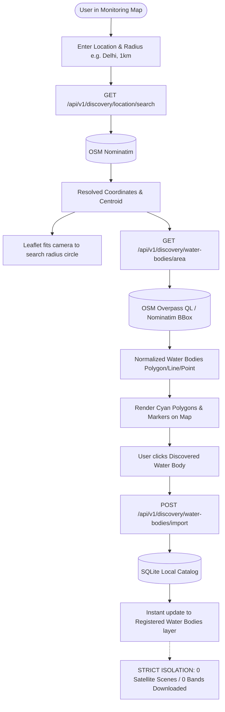

> Reference documentation imported from AADi2oo6/JalNetra2.O at commit 47567bbdc401a043de4cb53dc097fb915e7e6b62. Phase completion, test results, reset results, storage measurements, and frontend descriptions below refer to that source project. They are not verification results for this repository. The frontend has not yet been imported here.

# JalNetra 2.0 — Phase 2: Area-Wise Water-Body Discovery & Map Search

## Executive Summary

Phase 2 replaces the static pre-seeded catalog with a **dynamic, area-based spatial discovery workflow directly on the Monitoring Map**. Users can search any city, region, or landmark (e.g. Delhi, Pune, Nagpur, Ooty), select a search radius (500 m to 25 km), inspect discovered water bodies inside that spatial extent, and register selected water bodies into the local database with a single click.

Crucially, **no satellite data (Sentinel-2 scenes, bands, or rasters) is downloaded during discovery or registration**. Satellite search, acquisition, and processing remain strictly on-demand, user-triggered operations.

---

## 1. Architecture Overview



---

## 2. Backend Implementation

### A. Geocoding Service (`app/services/discovery/providers/osm.py`)
- Endpoint: `GET /api/v1/discovery/location/search?q={query}&limit={limit}`
- Uses OpenStreetMap Nominatim `jsonv2` with structured query and user agent.
- Caches geocoding responses in the local SQLite cache table with 7-day TTL (`geocode:osm:{query}:{limit}`).
- Returns parsed list of `GeocodedLocation` containing `display_name`, `latitude`, `longitude`, `type`, and `boundingbox`.

### B. Spatial Area Discovery Provider
- Endpoint: `GET /api/v1/discovery/water-bodies/area?latitude={lat}&longitude={lon}&radius_km={radius}&limit={limit}`
- Provider interface `WaterBodyDiscoveryProvider` with method `search_area(latitude, longitude, radius_km, limit)`.
- Queries Overpass API with structured query:
  ```overpass
  [out:json][timeout:25];
  (
    nwr["natural"="water"](around:{radius_m},{lat},{lon});
    nwr["water"](around:{radius_m},{lat},{lon});
    nwr["waterway"~"^(riverbank|dock)$"](around:{radius_m},{lat},{lon});
    nwr["landuse"~"^(reservoir|basin)$"](around:{radius_m},{lat},{lon});
  );
  out geom {limit};
  ```
- Gracefully falls back to secondary Overpass mirrors and Nominatim bounded viewbox search if primary Overpass endpoint is unreachable.
- Normalizes Overpass element geometry into GeoJSON `Polygon`, `LineString`, or `Point`.
- Calculates approximate water body area in $\text{km}^2$ using spherical geometry approximation and computes centroid coordinates.
- Caches area discovery results in local SQLite cache (`area:osm:{lat}:{lon}:{radius}:{limit}`).

### C. Import & Deduplication
- Endpoint: `POST /api/v1/discovery/water-bodies/import`
- Checks whether water body already exists via:
  1. `(source, source_id)` match
  2. `geometry_hash` match
  3. Spatial proximity (< 2 km centroid distance with identical name)
- If already present, idempotently returns the existing record without creating duplicates.
- If new, commits `WaterBody` record with geometry GeoJSON, centroid, and area.
- **Strict safety rule**: Never invokes Sentinel-2 discovery, downloads, or background tasks during import.

---

## 3. Frontend Implementation (`MapPage.tsx`)

### A. Discovery Tab & Controls
- Integrated into the left control panel as the first tab: `DISCOVERY | LAYERS | SCENES | AOI`.
- Auto-opens `DISCOVERY` tab when the database is empty (e.g. after Phase 1 clean reset).
- Fast shortcut button `🔍 AREA DISCOVERY` in the top GIS status pill.
- Radius selector with standard preset buttons: `500m`, `1km`, `2km`, `5km`, `10km`, `25km`.
- Multi-location resolver dropdown when search matches multiple locations.

### B. Map Symbology & Visualization
- **Search Extent**: Cyan dashed `<Circle>` (`#0891b2`, `fillColor: #06b6d4`, `fillOpacity: 0.05`) rendered dynamically at the search center.
- **Center Marker**: White & cyan `<CircleMarker>` at search coordinates with coordinates popup.
- **Discovered Polygons**: Cyan dashed `<GeoJSON>` vector polygons (`#0891b2`, `fillColor: #22d3ee`, `fillOpacity: 0.16`).
- **Discovered Markers**: Interactive `<CircleMarker>` at water body centroids with hover/click effects.
- **Interactive Popup**: Displays water body name, type, calculated area ($\text{km}^2$), source ID, and an inline `+ ADD TO JALNETRA` action button.
- **Status Reactive**: Marks registered water bodies with `✓ IN JALNETRA` badge and disables duplicate import buttons.

### C. Operation Feedback
- Top-right operation floating progress panel with live stage updates:
  - `Geocoding location...` (25%)
  - `Querying OpenStreetMap...` (65%)
  - `Area discovery complete ✓` (100%)
  - `Registering water body in JalNetra...`

---

## 4. Verification & Testing

- **Backend Test Suite**: 88 out of 88 tests pass (`backend/tests/test_phase2_discovery.py` includes 10 dedicated Phase 2 tests).
- **TypeScript & Vite Build**: Compiles cleanly with zero errors (`npm run build`).
- **Live Isolation Verified**: Confirmed 0 satellite scenes and 0 satellite assets created after area discovery and import.

