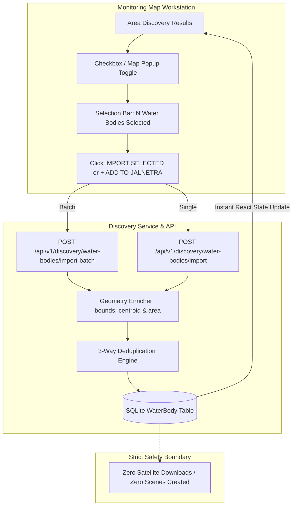

> Reference documentation imported from AADi2oo6/JalNetra2.O at commit 47567bbdc401a043de4cb53dc097fb915e7e6b62. Phase completion, test results, reset results, storage measurements, and frontend descriptions below refer to that source project. They are not verification results for this repository. The frontend has not yet been imported here.

# JalNetra 2.0 — Phase 3: Water Body Selection & Import

## Executive Summary

Phase 3 elevates water body selection and importing in JalNetra 2.0 into a deliberate, multi-select GIS workflow. Building on Phase 2's area discovery engine, Phase 3 allows users to:
1. Discover water bodies across any searched geographic extent (e.g. Pune, Delhi, Nagpur).
2. Inspect individual water bodies on the map or sidebar with distance-from-center metrics.
3. Select one or multiple discovered water bodies interactively using map popups, list checkboxes, or a "Select All Unregistered" shortcut.
4. Highlight selected items on the Leaflet map with high-contrast, blue polygon boundaries (`#2563eb`).
5. Execute batch or single-item registration into the local SQLite database via dedicated endpoints (`POST /api/v1/discovery/water-bodies/import` and `POST /api/v1/discovery/water-bodies/import-batch`).
6. Update registered layers, vector boundaries, and the authoritative water body selector immediately without full page reload.
7. **Strict Safety Invariant**: Guarantee zero automatic satellite downloads, scenes, bands, or processing triggers during the import workflow.

---

## 1. Architecture & Workflow

---

## 2. Backend Implementation

### A. Batch Import Request & Response Models (`backend/app/services/discovery/models.py`)
- `BatchImportRequest`: Pydantic payload validating a non-empty list of `WaterBodyDiscoveryResult` items (`min_length=1`, `max_length=50`).
- `BatchImportItemResult`: Per-item report with `source_id`, `name`, `status` (`"imported"` | `"already_registered"` | `"failed"`), optional `water_body: WaterBodyRead`, and optional `error: str`.
- `BatchImportResponse`: Summary response reporting:
  - `total_requested`: Total items submitted.
  - `imported_count`: Newly created records.
  - `already_existed_count`: Records matched by deduplication.
  - `failed_count`: Any malformed/failed items.
  - `results`: Ordered list of `BatchImportItemResult`.

### B. Geometry Derivation & Deduplication (`backend/app/services/discovery/service.py`)
- `_enrich_discovery_geometry`: Automatically derives `centroid_lat`, `centroid_lon`, `min_lat`, `max_lat`, `min_lon`, `max_lon`, and approximate `area_sq_km` from GeoJSON if omitted by the external provider.
- `import_water_body_with_status`: Implements the 3-way deduplication engine:
  1. `(source, source_id)` match against existing database records.
  2. `geometry_hash` match.
  3. Spatial proximity check ($< 2\text{ km}$ centroid distance with identical normalized name).
  Returns `(water_body, is_new)` indicating whether the record was created or resolved to an existing entry.
- `import_water_bodies_batch`: Iterates over the requested batch, processes each item transactionally, and aggregates counts and per-item results.

### C. REST API Endpoint (`backend/app/api/v1/discovery.py`)
- `POST /api/v1/discovery/water-bodies/import-batch`:
  - Request: `{"water_bodies": [...]}`
  - Status Code: `200 OK` (or `422 Unprocessable Content` if empty or invalid payload).
  - Response: `BatchImportResponse` with full audit trace.

---

## 3. Frontend Implementation (`frontend/src/pages/MapPage.tsx`)

### A. Multi-Selection State Management
- `selectedForImportIds: Set<string>`: Tracks discovered water bodies selected for import by their `source_id`.
- `toggleSelectForImport(sourceId)`: Adds or removes items without triggering camera movements or clearing existing discovery results.
- `handleSelectAllUnregistered()`: Convenience action selecting all unimported items in the current search radius.
- `handleClearSelection()`: Resets multi-selection state.

### B. Map Visual Hierarchy
- **Discovered Polygons (`<GeoJSON>`)**:
  - Selected for import: Bold solid blue outline (`#2563eb`, weight 3.5, fill `#38bdf8` at 45% opacity).
  - Active previewed item: Cyan dashed outline (`#0284c7`, weight 3, fill `#38bdf8` at 35% opacity).
  - Unselected item: Subtle cyan dashed outline (`#0891b2`, weight 2, fill `#22d3ee` at 16% opacity).
  - Already registered: Green outline (`#16a34a`, weight 2, fill `#4ade80` at 16% opacity).
- **Map Popups (`<Popup>`)**:
  - Displays water body name, type, area, and computed distance from search center (e.g. `1.85 km away`).
  - Dual action buttons: `☑ SELECT FOR IMPORT` toggle and `+ ADD DIRECTLY TO JALNETRA`.

### C. DISCOVERY Sidebar UI
- **Selection Summary Bar**:
  - Displays `📦 N WATER BODIES SELECTED FOR IMPORT`.
  - Primary button: `[ ⬇ IMPORT SELECTED (N) ]` with live operation progress.
  - Secondary button: `[ CLEAR ]`.
- **Quick Action Row**:
  - `[ Select All Unregistered ]` and `[ Deselect All ]`.
- **Water Body Cards**:
  - Interactive checkbox for batch selection.
  - Water body name, type badge, area, distance from search center, and provider tag.
  - Quick select toggle (`✓ SELECTED` vs `+ SELECT`) and single-click direct import.
  - Already registered items show `✓ IN JALNETRA` badge and disabled checkbox.

---

## 4. Strict Safety Verification

1. **Zero Automatic Downloads**: Neither single import nor batch import calls STAC APIs, creates `SatelliteScene` records, downloads Sentinel-2 bands, or generates rasters.
2. **Idempotence Verified**: Importing the same batch repeatedly returns `already_registered` with zero database duplicates.
3. **Database Integrity**: The total satellite scenes and assets remain unchanged after any import operation.
4. **Automated Test Suite**:
   - `backend/tests/test_phase3_import.py`: 6 dedicated unit and integration tests covering single import, batch import, deduplication, geometry enrichment, 422 validation, and the zero-satellite safety invariant.
   - 94 out of 94 tests passing across the entire repository.

